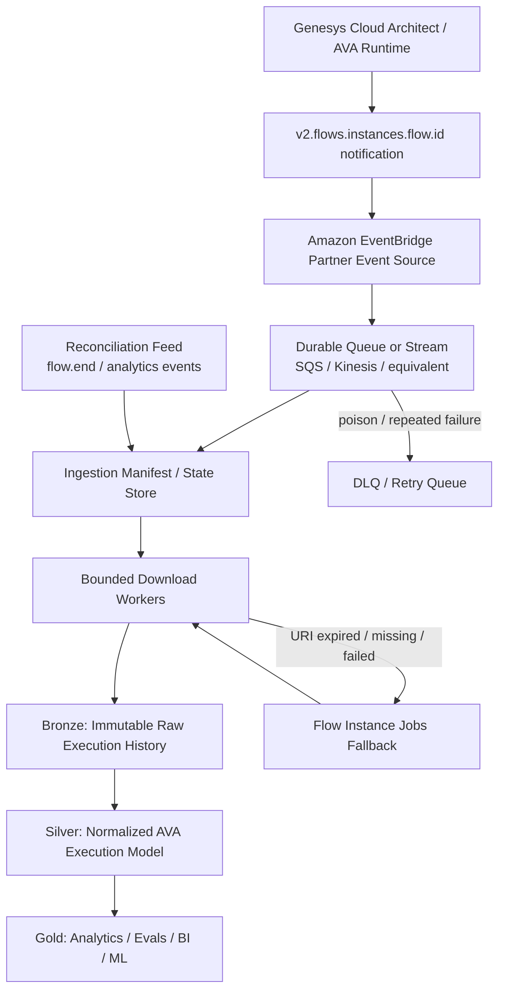

# Genesys Cloud AVA Explainability at Scale

**Status:** Proposed target architecture, with explicit validation gates before production sign-off  
**Scope:** Large-scale external collection and analysis of Genesys Cloud Agentic Virtual Agent (AVA) historical execution data from Architect flows  
**Primary objective:** Obtain the richest AVA execution history available from Genesys Cloud while minimizing Platform API calls, avoiding polling, remaining resilient under extreme volume, and preserving data externally for deep analytics.

> [!IMPORTANT]
> **This document has been superseded in three material respects by live validation.** It is kept
> as the original design rationale; read [`docs/validation-log.md`](docs/validation-log.md) for
> the measured behaviour before implementing anything below.
>
> 1. **There is no signed download URI.** `executionHistoryUri` and `executionHistoryUriTtl` are
>    declared in the topic schema but were populated on **none** of the events actually delivered.
>    The happy path described in Section 1 and detailed in Sections 4 and 5 does not exist.
>    All retrieval goes through the Jobs API; the notification's `endpoint` field is a relative
>    API path whose GET *creates a Jobs job* rather than returning content. Validation gate 5
>    (signed URI TTL) is consequently inapplicable.
> 2. **The documented field limits in Section 10 do not bind.** Data Action responses of 1,732
>    characters, strings of 2,918 characters and collections of 253 items were all stored and
>    retrieved intact, against documented caps of 1,000 / 253 / 20. So the Genesys record carries
>    full tool request and response payloads, and the external tool-boundary telemetry offered in
>    Section 10 remains **optional** rather than becoming mandatory.
>
> 3. **Executions that never reach their flow's exit are invisible to this architecture.** No
>    execution history is written for them, so no notification is emitted, so reconciliation has
>    nothing to find either - they are outside both mechanisms rather than lost by one. Measured on
>    two digital bot flows, including one that delivered 4 of 4 events when its sessions ran to
>    completion. Every coverage or completeness claim in this document should be read as scoped to
>    completed executions, and abandonment analysis needs a separate source.
>
> Everything else in the document held up, including the conclusion that the inline `execution[]`
> is unusable on its own and that the history must be downloaded. Notification delivery, once
> tested against a flow that genuinely invokes an AVA and driven to the flow's own exit, was
> complete: 4 of 4.
>
> One operational warning that is not in the document: `agenticVirtualAgentEnabled` on the flow
> object drifts, in both directions - flags change on existing flows and new AVA flows appear. The
> registry count moved 59 -> 58 -> 59 within one day. Confirm AVA presence from
> `actionCallAgenticVirtualAgent` in a recovered artifact rather than trusting the flow-level flag,
> and never treat absence from a registry build as evidence that a flow is not an AVA flow.

---

## 1. Executive summary

Genesys Cloud exposes detailed AVA runtime debugging information through Architect Historical Execution Data. As of May 18, 2026, Genesys explicitly documents public-API access to AVA execution history including Data Action inputs and outputs, guardrail information, and knowledge query and response details. Architect execution history can also expose ordered tool calls, latency, status, AVA outcome, and exit reason.

For high-volume extraction, the recommended architecture is **event driven**, centered on the EventBridge-compatible notification topic:

```text
v2.flows.instances.flow.{id}
```

The schema available in the target Genesys Cloud organization contains three properties that materially change the scaling model:

- `executionId`: unique identifier for the flow execution instance.
- `executionHistoryUri`: signed URI to download execution history data.
- `executionHistoryUriTtl`: lifetime of that signed URI.

It also contains:

- `endpoint`: described as a public endpoint that can retrieve the full historical log.
- `executionItemsTruncated`: explicitly indicates that the inline `execution[]` carried in the notification may have been truncated to make the event deliverable.

Therefore, **the inline EventBridge event must not be treated as the authoritative complete trace**. The proposed happy path is instead:

```text
Genesys Cloud
    => v2.flows.instances.flow.{id}
    => Amazon EventBridge
    => durable AWS queue/stream
    => download executionHistoryUri immediately
    => immutable raw object storage
    => normalize/enrich
    => external lakehouse / big-data analysis
```

The Genesys Flow Instance Jobs APIs remain an important **fallback and recovery path**:

```http
POST /api/v2/flows/instances/jobs
GET  /api/v2/flows/instances/jobs/{jobId}
```

However, before removing Jobs from the normal ingestion path, several points must be validated empirically. The most important is proving that the file behind `executionHistoryUri` contains the same AVA detail as the richest execution-history artifact obtainable via Jobs, including any relevant `expand` behavior.

> [!IMPORTANT]
> **Production decision gate:** Until the equivalence tests in Section 11 pass, use EventBridge for zero-poll discovery but keep the Jobs path available as the authoritative comparison and fallback mechanism.

---

## 2. What data is required for AVA explainability

The external analytics system should aim to preserve enough information to reconstruct, at minimum:

- Which Architect flow and version ran.
- Which AVA invocation occurred within that flow.
- Parent/child flow invocation context.
- Ordered AVA/tool execution sequence.
- Tool identity and type.
- Data Action calls.
- Knowledge tool calls.
- Tool inputs and outputs, where Genesys stored them.
- Knowledge queries and returned knowledge details, where available.
- Guardrail events and blocked tool calls.
- Tool status: success, timeout, error, blocked.
- Tool and action latency/timing.
- Flow errors and warnings.
- Flow exit reason.
- AVA outcome such as contained, handed off, or escalated where present in the historical data.
- Conversation, flow, participant/session, and external-contact correlation identifiers where available.
- Truncation markers such as `valueIsTooLarge` and event-level `executionItemsTruncated`.

Genesys documentation confirms that AVA execution history can provide Data Action inputs/outputs, guardrail details, knowledge query/response details, ordered tool invocation information, latency, execution status, and AVA exit/outcome information.

---

## 3. Mandatory Genesys Cloud configuration

The extraction architecture only works if Genesys Cloud captures sufficiently detailed historical execution data in the first place.

### 3.1 Enable historical execution data

Historical execution-data storage is disabled by default. It must be enabled at organization level for Architect flows, and affected flows must be republished.

Relevant API family:

```http
GET   /api/v2/flows/instances/settings/executiondata
PATCH /api/v2/flows/instances/settings/executiondata
```

### 3.2 Use the `All` execution-data level for AVA-containing flows

Genesys exposes four execution-data levels:

1. Base
2. Notes
3. Verbose Notes
4. All

For low-level AVA explainability, **All** is the required target because Genesys describes it as the level used to troubleshoot action input and output values.

Flow-specific overrides are preferable to globally increasing every Architect flow if only selected flows require deep observability.

Relevant API family:

```http
GET    /api/v2/flows/{flowId}/instances/settings/loglevels
POST   /api/v2/flows/{flowId}/instances/settings/loglevels
PUT    /api/v2/flows/{flowId}/instances/settings/loglevels
DELETE /api/v2/flows/{flowId}/instances/settings/loglevels
```

> [!IMPORTANT]
> If a flow is not recorded at a sufficiently detailed level, no downstream EventBridge, Jobs, lakehouse, or analytics architecture can recreate information Genesys never stored.

---

## 4. Primary notification topic

### `v2.flows.instances.flow.{id}`

This is the key topic for scalable collection.

The target-org schema provided for this topic contains:

```text
executionId
conversationId
divisionId
startDateTime
endDateTime
endpoint
errors[]
execution[]
flowExitReason
flowId
flowIsDebug
executionItemsTruncated
flowType
flowVersion
messageType
invokingContext
warnings[]
executionHistoryUri
executionHistoryUriTtl
```

The decisive semantics are:

- `executionId` represents the unique instance of the flow that ran.
- `executionHistoryUri` is a signed URI for downloading execution history data.
- `executionHistoryUriTtl` is the TTL of that signed URI.
- `endpoint` is described as a public endpoint that can retrieve the full historical log.
- `executionItemsTruncated=true` means the inline event execution items have been truncated for delivery.

### Why this topic is preferable to polling

With Amazon EventBridge integration, Genesys topic selection is organization-wide: `{id}` is not replaced with one specific flow ID in the Genesys integration configuration. Matching events for the selected topic are sent for the organization and can then be filtered/routed in AWS.

That means the collector does not need to:

- poll conversations;
- query every conversation for flow-instance IDs;
- create one notification subscription per flow instance;
- repeatedly scan `/flows/instances/query`.

This removes the highest-volume category of avoidable Platform API calls.

---

## 5. Target architecture



### 5.1 Happy path

1. Genesys completes or records a flow execution.
2. `v2.flows.instances.flow.{id}` is delivered through the Genesys Amazon EventBridge integration.
3. AWS routes the event to a durable queue or stream.
4. The collector persists a manifest record before attempting the download.
5. The collector computes/records URI expiry from `executionHistoryUriTtl`.
6. A bounded worker downloads the file from `executionHistoryUri` before expiry.
7. The raw file is written unchanged to immutable object storage.
8. Downstream processing normalizes the data into AVA/tool/knowledge/guardrail records.
9. Analytics are performed against the normalized or curated layers, never against the transient Genesys retention window.

### 5.2 Fallback path

If the signed URI is missing, expired, or repeatedly fails:

1. Place the corresponding execution in a recovery queue.
2. Group recovery items into adaptive micro-batches.
3. Submit them through:

```http
POST /api/v2/flows/instances/jobs
```

4. Poll the asynchronous job conservatively:

```http
GET /api/v2/flows/instances/jobs/{jobId}
```

5. Retrieve only the failed/missing execution files.
6. Persist them into the same Bronze/raw storage.

### 5.3 Last-resort forensic recovery

`POST /api/v2/flows/instances/query` should not be the normal harvesting mechanism. Genesys documents a maximum of 200 execution instances per query, does not guarantee that those are the newest 200, and does not support querying by flow start/end datetime.

Use the query API only when a reconciliation signal proves data is missing and the known `conversationId` can narrow the search.

---

## 6. Why Jobs remain important even if direct EventBridge download is adopted

The bulk Jobs endpoint is the right **recovery primitive** because one asynchronous job can accept an array of execution-data IDs instead of creating one preparation job per execution.

```http
POST /api/v2/flows/instances/jobs
```

Conceptually:

```json
{
  "ids": [
    "execution-id-1",
    "execution-id-2",
    "execution-id-3"
  ]
}
```

The completed job is checked through:

```http
GET /api/v2/flows/instances/jobs/{jobId}
```

and returns per-execution results/download links.

This is preferable to starting a singular preparation job for every execution.

### Adaptive batching

Do not hard-code an undocumented maximum batch size. The OpenAPI contract has historically exposed request-too-large behavior, while the effective maximum number of IDs is not a safe architectural constant.

Recommended behavior:

```text
start with configured safe batch size
    => success: keep batch size
    => 413 / size failure: split batch and retry halves
    => 429: honor Retry-After and reduce concurrency
    => partial item failures: retry only failed IDs
```

---

## 7. Scaling characteristics

Let:

- `E` = number of flow/AVA executions to archive
- `B` = recovery IDs per bulk job
- `P` = average number of status polls per job

### Jobs-first design

Approximate Genesys control-plane calls:

```text
ceil(E / B) POST job calls
+
ceil(E / B) * P status GETs
+
E execution-file downloads
```

### EventBridge direct-download design

Normal happy path:

```text
0 flow-instance discovery API calls
0 job POSTs
0 job polling GETs
E execution-history downloads
```

Only the actual movement of the data remains proportional to volume. This is close to the theoretical minimum for exporting every execution.

The Jobs API then handles only exceptions, backfill, or recovery.

---

## 8. Resilience design

The external collector should assume duplicates, retries, delayed delivery, partial failures, worker restarts, URI expiry, and temporary throttling.

### 8.1 Idempotency

Use `executionId` as the primary idempotency candidate, together with organization/region context if the product is multi-org.

Example manifest key:

```text
{genesysOrgId}:{executionId}
```

Persist state transitions such as:

```text
EVENT_RECEIVED
DOWNLOAD_PENDING
DOWNLOADING
ARCHIVED
NORMALIZED
RECOVERY_REQUIRED
JOB_SUBMITTED
FAILED_PERMANENTLY
```

### 8.2 Download-before-expiry priority

Store at least:

```text
executionId
conversationId
flowId
flowVersion
flowType
startDateTime
endDateTime
executionHistoryUri
executionHistoryUriTtl
eventReceivedAt
calculatedExpiryAt
downloadStatus
retryCount
archiveLocation
```

Queue priority should increase as `calculatedExpiryAt` approaches.

### 8.3 Backpressure

Bound worker concurrency independently for:

- EventBridge/SQS consumption.
- Signed execution-history downloads.
- Genesys Platform API job submissions.
- Job-status polling.
- Normalization/warehouse loading.

A slowdown in Genesys or the analytics backend should create backlog, not request storms.

### 8.4 Rate-limit handling

For Platform API operations:

- honor `Retry-After`;
- use exponential backoff with jitter;
- reduce concurrency after 429s;
- retry individual failed IDs rather than whole successful batches;
- do not create extra OAuth clients merely to evade limits.

### 8.5 Reconciliation

Use a secondary lifecycle signal to detect missing archived histories.

Candidate topic:

```text
v2.detail.events.conversation.{id}.flow.end
```

Its provided schema contains conversation/participant/session identifiers, flow type, flow ID/version, exit reason, and timing context, but does not contain `executionHistoryUri` or an obvious execution-history ID.

Therefore it should be used as an **audit/reconciliation signal**, not the primary extraction source.

Example daily/near-real-time check:

```text
known completed AVA-relevant flows
    vs
archived execution histories
```

Any gap enters targeted recovery. Only those exceptional cases should invoke conversation-scoped flow-instance queries if necessary.

---

## 9. External data architecture

### Bronze - immutable evidence

Store unchanged:

- complete downloaded Genesys execution-history file;
- original EventBridge envelope/body;
- ingestion timestamps;
- URI TTL metadata;
- source topic;
- hash/checksum;
- collector version;
- recovery method used (`direct-uri`, `job`, `query-recovery`).

Never discard the raw source after normalization. It allows reprocessing when Genesys adds new AVA fields or the parser improves.

### Silver - normalized explainability model

Recommended entities:

```text
ava_execution
flow_execution
tool_invocation
data_action_invocation
knowledge_invocation
guardrail_event
flow_action_execution
execution_error
execution_warning
ava_outcome
flow_invocation_edge
```

Useful normalized keys:

```text
org_id
conversation_id
flow_execution_id
parent_flow_execution_id
flow_id
flow_version
flow_type
ava_execution_id
action_execution_id
tool_invocation_id
tool_name
tool_type
start_time
end_time
latency_ms
status
input_payload
output_payload
truncation_flag
error_reason
exit_reason
```

### Gold - analytical products

Examples:

- tool success/error/timeout rate;
- p50/p95/p99 tool latency;
- knowledge usage and success patterns;
- guardrail-trigger rates;
- AVA containment/handoff/escalation rates;
- tool sequence analysis;
- error clustering;
- flow-version regression analysis;
- UAT/evaluation scoring;
- cohort analysis by queue, flow, intent, customer segment, channel, or release version;
- AVA behavior drift;
- root-cause correlation between tool failures and AVA outcomes.

---

## 10. Hard platform limits: "full execution history" is not necessarily lossless tool telemetry

Even if EventBridge direct download proves fully equivalent to Jobs, both mechanisms ultimately depend on what Genesys Historical Execution Data stored.

Genesys currently documents important limits including:

| Historical execution constraint | Current documented limit |
|---|---:|
| Retention | 10 days |
| Query results | Maximum 200 execution instances |
| JSON value | 1,000 characters |
| String value | 253 characters |
| Collection | 20 items |
| Call-flow action executions | First 4,500 |
| Flow running longer than 3 days | Historical execution not stored |
| Call flow with more than 350 variables | Base-level recording only |
| Secure flow | Base-level reporting only |

Oversized stored values can be represented with `valueIsTooLarge: true`.

Therefore:

> [!CAUTION]
> **Parity with Jobs is not the same as lossless wire-level telemetry.** If the requirement is to preserve every byte of large Data Action/tool requests and responses, the Genesys historical-execution dataset alone cannot guarantee it.

### Optional full-fidelity tool telemetry

For truly forensic analytics, add telemetry at the external tool/API boundary:

```text
AVA / Data Action
    => external API gateway / service / function
        => full request payload
        => full response payload
        => status code
        => latency
        => retries
        => downstream errors
        => correlation ID
```

Correlate this with the Genesys execution record using a safe correlation strategy such as conversation ID plus a generated invocation/correlation ID where architecture allows it.

This produces two complementary sources:

- **Genesys execution history:** authoritative record of what the AVA/Architect runtime did and observed.
- **Tool-side telemetry:** full-fidelity technical request/response evidence where permitted by privacy/security requirements.

---

## 11. VALIDATION GATES BEFORE PRODUCTION SIGN-OFF

The following points must be validated. They are intentionally highlighted because they determine whether Jobs can be removed from the happy path and whether the external dataset meets the intended fidelity.

### VALIDATION 1 - Direct `executionHistoryUri` vs Jobs artifact equivalence

**Question:** Does `executionHistoryUri` return the same historical execution detail as the Jobs `downloadUri` for the same execution?

Test one or more AVA executions containing:

- multiple Data Action calls;
- meaningful input/output payloads;
- knowledge calls;
- a guardrail event if possible;
- success and error/timeout cases;
- non-trivial nested flow execution.

For each execution, collect:

```text
A = EventBridge executionHistoryUri file
B = Jobs downloadUri file
```

Compare:

1. cryptographic hash, if identical serialization is expected;
2. JSON structural diff;
3. semantic field-by-field diff for AVA/tool/knowledge/guardrail data.

**Pass condition:** A contains all AVA execution information available in B. Byte-for-byte equality is desirable but not required if serialization differs while semantics are identical.

**Architecture impact:**

- PASS => EventBridge direct download can be the normal path.
- FAIL => EventBridge remains discovery/trigger only; Jobs remains the authoritative retrieval path.

---

### VALIDATION 2 - Effect of Jobs `expand` options

**Question:** Do Jobs retrieval options such as AVA/bot/Data Action expansions produce additional information that is absent from the direct signed EventBridge download?

Compare, for the same execution:

```text
A = EventBridge executionHistoryUri
B = Job with default retrieval
C = Job with bot-related expansion, if supported in current OpenAPI
D = Job with Data Action-related expansion, if supported in current OpenAPI
```

**Pass condition:** A contains all fields required for AVA explainability that are present in the richest supported Jobs result.

**Architecture impact:** This is the most important check after Validation 1 because a direct URI may point to the base history while the Jobs API may apply enrichments.

---

### VALIDATION 3 - `executionId` is accepted by the bulk Jobs API

**Question:** Is the notification `executionId` exactly the identifier expected in `POST /api/v2/flows/instances/jobs` `ids[]`?

Do not rely only on similar naming.

**Pass condition:** A failed/expired direct download can be recovered by placing the event's `executionId` directly into a bulk Jobs request.

**Architecture impact:** Required for a clean zero-query fallback path.

---

### VALIDATION 4 - Exact semantics of `endpoint`

The notification schema describes `endpoint` as the public endpoint used to retrieve the full historical log.

Validate:

- the exact URL/path shape;
- required authentication;
- whether it refreshes or redirects to a new signed URI;
- whether it remains usable after `executionHistoryUri` expires;
- whether it returns the same artifact as Jobs.

**Potential benefit:** `endpoint` may provide an even simpler recovery path before falling back to Jobs.

---

### VALIDATION 5 - Signed URI TTL and expiry behavior

Validate in the target org/region:

- typical `executionHistoryUriTtl` values;
- whether TTL begins at event generation or URI generation;
- behavior at/after expiry;
- whether redirects alter expiry semantics;
- whether a fresh URI can be obtained without a Jobs request.

**Architecture impact:** Determines queue SLA, retry timing, and how quickly events must be archived.

---

### VALIDATION 6 - Signed-download throughput and rate-limit domain

**Question:** Are `executionHistoryUri` downloads subject to normal Genesys Platform API rate limits, a separate download-service limit, object-store throttling, fair-use constraints, or other concurrency limits?

Validate:

- download hostname/service;
- HTTP response headers under load;
- 429/5xx behavior;
- recommended concurrency;
- any documented fair-use/egress constraints;
- whether downloads require an OAuth token or only the signature.

**Architecture impact:** Determines safe download-worker concurrency at extreme volume.

---

### VALIDATION 7 - EventBridge delivery semantics for this topic

The collector must empirically and contractually understand:

- duplicate delivery behavior;
- ordering guarantees, if any;
- retry window;
- maximum event size;
- failure behavior between Genesys and the AWS partner event source;
- expected latency;
- whether an event can arrive before the execution-history file is actually downloadable.

**Design regardless of result:** idempotent processing, durable queue, retries, and reconciliation remain mandatory.

---

### VALIDATION 8 - Topic availability and schema consistency across orgs/regions

Genesys available topics can vary by organization and evolve over time.

For every target org:

- confirm `v2.flows.instances.flow.{id}` is available for EventBridge;
- confirm the schema includes `executionId`, `executionHistoryUri`, `executionHistoryUriTtl`, `endpoint`, and `executionItemsTruncated`;
- capture/version the discovered schema during onboarding;
- alert on incompatible schema changes.

**Architecture impact:** Required if this is intended as a reusable product rather than a one-org implementation.

---

### VALIDATION 9 - Identifying AVA-containing flows without unnecessary downloads

`flowType=BOT` or `DIGITALBOT` does not necessarily prove that every such flow execution invoked an AVA.

Validate the cheapest reliable filter, for example:

- maintain a registry of known AVA-containing `flowId`s;
- identify an AVA-specific execution item in the notification when the inline data is not truncated;
- obtain configuration metadata out of band and cache it;
- or download all relevant bot-flow histories if volume/cost is acceptable.

**Architecture impact:** Determines how much unnecessary execution-history data is transferred.

---

### VALIDATION 10 - AVA field completeness across scenarios

Create a validation matrix covering at least:

| Scenario | Expected evidence |
|---|---|
| Data Action success | tool/action identity, inputs, outputs, latency, success |
| Data Action timeout | identity, inputs if available, timeout, latency |
| Data Action error | identity, inputs if available, error/status, latency |
| Guardrail block | blocked status and guardrail details |
| Knowledge lookup | query and response/retrieval details |
| AVA containment | final outcome/exit details |
| Human handoff | handoff outcome and reason |
| Customer escalation | escalation outcome and reason |
| Nested flow invocation | parent and child execution linkage |
| Voice bot flow | required AVA details preserved |
| Digital bot flow | required AVA details preserved |

**Pass condition:** The external normalized model can reconstruct every use case required by the explainability product.

---

### VALIDATION 11 - Historical-execution truncation impact on intended analytics

Use deliberately large test values to verify actual behavior for:

- JSON > 1,000 characters;
- string > 253 characters;
- collections > 20 items.

Confirm how AVA Data Action input/output data represents truncation and whether important low-level fields are lost.

**Architecture impact:** Determines whether full-fidelity external tool telemetry is mandatory for the product's stated requirements.

---

### VALIDATION 12 - Reconciliation strategy proves no silent data loss

Run an end-to-end volume test comparing:

```text
completed relevant flow executions
vs
v2.flows.instances.flow.{id} events received
vs
raw execution histories archived
vs
normalized AVA records produced
```

Inject failures deliberately:

- consumer unavailable;
- signed URI allowed to expire;
- duplicate notification;
- worker killed mid-download;
- partial Jobs failure;
- 429 throttling;
- transient 5xx;
- malformed/unexpected payload.

**Pass condition:** Every recoverable execution reaches `ARCHIVED`, and unrecoverable gaps are surfaced by reconciliation rather than silently disappearing.

---

## 12. Recommended rollout

### Phase 1 - Prove data equivalence

Build a small validation harness that records the same AVA execution through:

1. EventBridge notification body.
2. EventBridge `executionHistoryUri`.
3. Jobs default artifact.
4. Every relevant Jobs expansion supported by the current OpenAPI.

Generate automated JSON/semantic diffs.

### Phase 2 - Conservative production path

Until equivalence is proven:

```text
EventBridge
    => executionId discovery
    => durable micro-batch
    => Jobs
    => download
    => raw lake
```

This already eliminates conversation polling and per-conversation discovery calls.

### Phase 3 - Optimized target path

After validations pass:

```text
EventBridge
    => direct executionHistoryUri download
    => raw lake

Jobs used only for:
    - expired URI
    - failed direct download
    - backfill
    - reconciliation repair
    - forensic re-retrieval within retention
```

### Phase 4 - Full-fidelity augmentation

If historical-execution truncation prevents the required analytics, add tool-side request/response telemetry and correlate it with Genesys execution history.

---

## 13. Recommended final position

The strongest architecture currently indicated by the available schemas is:

> **Use `v2.flows.instances.flow.{id}` through Amazon EventBridge as the zero-poll, organization-wide notification source. Persist every notification durably, immediately download the signed `executionHistoryUri` into immutable external storage, and use bulk Flow Instance Jobs only for recovery/backfill. Use targeted `/flows/instances/query` only as a last-resort forensic mechanism.**

This architecture minimizes Genesys Platform API control-plane usage while retaining a resilient recovery mechanism and an immutable external dataset suitable for high-volume AVA explainability analytics.

However, it should not be considered production-proven until the validation gates in Section 11 are completed, especially:

1. EventBridge signed history vs Jobs data equivalence.
2. Impact of Jobs expansion options.
3. Notification `executionId` compatibility with Jobs `ids[]`.
4. Signed-download rate/throughput behavior.
5. End-to-end reconciliation under failure.

Even after those pass, Genesys Historical Execution Data remains subject to its own storage/truncation rules. If "all detail" means lossless large tool request/response bodies, supplement the Genesys trace with telemetry captured at the external tool boundary.

---

## 14. References

Official Genesys Cloud sources:

- Genesys Cloud release notes, May 18, 2026 - "View AVA execution history via public API":  
  https://help.genesys.cloud/release-notes/genesys-cloud/may-18-2026/

- Test and troubleshoot agentic virtual agents:  
  https://help.genesys.cloud/articles/test-and-troubleshoot-agentic-virtual-agents/

- Historical execution data overview:  
  https://help.genesys.cloud/articles/historical-execution-data-overview/

- Manage historical execution data:  
  https://help.genesys.cloud/articles/manage-historical-execution-data/

- Manage execution data at the flow level:  
  https://help.genesys.cloud/articles/manage-execution-data-at-the-flow-level/

- Configure the Amazon EventBridge integration:  
  https://help.genesys.cloud/articles/configure-the-amazon-eventbridge-integration/

- About the Amazon EventBridge integration:  
  https://help.genesys.cloud/articles/about-the-amazon-eventbridge-integration/

- Genesys Cloud Platform API Swagger definition:  
  https://api.mypurecloud.com/api/v2/docs/swagger

Target-org notification schemas supplied for this analysis:

- `v2.flows.instances.flow.{id}`
- `v2.detail.events.conversation.{id}.flow.end`
- `v2.detail.events.conversation.{id}.flow.start`
- `v2.detail.events.conversation.{id}.flow.outcome`

